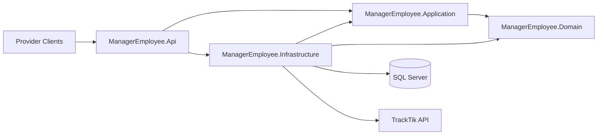
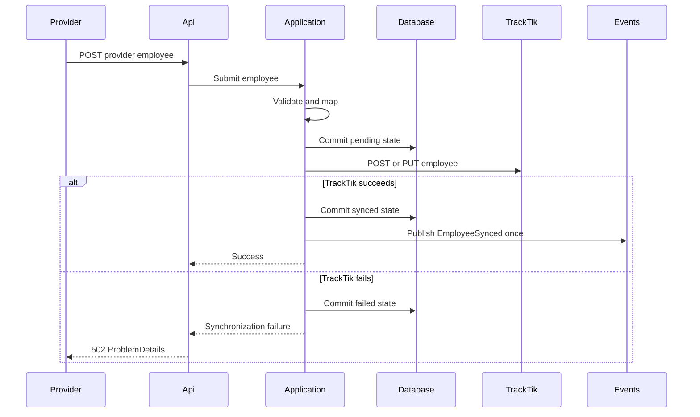

# ManagerEmployee Architecture

## Context

ManagerEmployee receives employee submissions from two providers, validates and maps each provider format, persists synchronization state in SQL Server, and forwards employees to TrackTik. Provider validation and mapping, the normalized employee domain model, direct command/query use cases, EF Core write persistence and no-tracking reads, synchronization orchestration, and in-memory event publication are established. The versioned employee API and the OAuth2 TrackTik HTTP client are implemented.

## Architectural Style

The solution uses a lightweight hybrid layered architecture with direct command/query separation. Projects define dependency boundaries, and behavior is organized by employee feature within the project that owns it. ASP.NET Core controllers provide the HTTP transport boundary without introducing a mediator or dispatcher framework.

Dependencies point toward Domain and Application policy. The API references Infrastructure because it is the composition root that activates concrete adapters.

## Project Boundaries

### ManagerEmployee.Domain

Owns the normalized `Employee`, self-validating identity/profile/attempt/error values, field-limit policy, provider and status types, synchronization-state invariants, the typed `EmployeeSynced` event, and the employee aggregate repository abstraction. It has no project references or external package dependencies.

### ManagerEmployee.Application

Owns the directly injected synchronization command handler and employee query handler, immutable use-case models, provider mapping contracts, and external-system, event-publisher, and read-store ports. It consumes the Domain-owned employee repository abstraction. It references Domain and remains independent from ASP.NET Core, EF Core, SQL Server, and concrete HTTP clients.

### ManagerEmployee.Infrastructure

Implements the EF Core context, tracked employee write repository, no-tracking employee read store, SQL Server mapping, migrations under `Persistence/Migrations`, expected conflict translation, the mandatory in-memory event publisher, and the TrackTik HTTP client with OAuth token acquisition and caching.

#### Providers

`Infrastructure/Providers/Provider1` and `Infrastructure/Providers/Provider2` own each provider's external JSON model, a FluentValidation validator, and an `IProviderEmployeeMapper`. Validators compose the shared rules in `ProviderFieldRules` and report errors under the provider's JSON field names (for example `personal_info.email`). Provider DTOs are internal; mappers return the application-owned `MappedEmployee` and never pass provider objects into Domain or persistence. The command handler resolves the mapper by parsing the route value with `EmployeeProviderExtensions.TryParseContractValue`.

### ManagerEmployee.Api

Owns controllers, HTTP contracts, `ProblemDetails`, OpenAPI, middleware, and dependency composition. Controllers translate transport input into application use cases; they do not map providers, orchestrate synchronization, access EF Core directly, or acquire OAuth tokens.

## Non-Negotiable Behavior

The following contract is preserved by service-layer behavior and must remain intact when transport and HTTP adapters are implemented:

1. Employee identity is `(provider, providerEmployeeId)`, never email. TrackTik `employeeId` is `{provider}-{providerEmployeeId}`.
2. A valid request is processed in this order: validate, map, commit `pending`, call TrackTik, then commit `synced` or `failed`.
3. A TrackTik failure leaves the employee committed as `failed` and produces a `502 ProblemDetails` response containing the synchronization status.
4. Resubmission updates the existing local row and retries synchronization.
5. TrackTik POST is used only when local persisted state shows the employee has never synchronized successfully. PUT is used after any prior successful creation.
6. `EmployeeSynced` is published exactly once per successful synchronization and only after the `synced` status commit succeeds.
7. The OAuth token URL is configured separately from the TrackTik `/v1` API base URL.

## Expected Request Sequence

The two database commits around the external call are intentional. The first preserves the attempt even if TrackTik is unavailable; the second records its outcome.

## Persistence Boundary

Migrations are applied explicitly with `dotnet ef database update` (the API is the startup project, so there is no separate design-time configuration), or at API startup when `Database:ApplyMigrationsOnStartup` is true (Compose enables it so reviewers do not need EF tooling).

Domain defines the employee aggregate repository abstraction, following the aggregate-oriented repository pattern used by the [ABCCompany](https://github.com/Dalben06/AbcCompany) and [Equinox](https://github.com/EduardoPires/EquinoxProject) examples. Application consumes that abstraction to coordinate explicit pending and outcome commits, while Infrastructure implements it with EF Core and SQL Server. The contractual pair `(provider, providerEmployeeId)` is the primary key. The database also enforces lowercase status check constraints and optimistic concurrency through `rowversion`. A separate Application read-store port is implemented with `AsNoTracking` projection to `EmployeeDetails`. A generic repository is intentionally excluded because it would hide synchronization-specific operations and commit boundaries. See ADRs 0002 and 0003.

## Command, Query, And Event Boundaries

- `SyncEmployeeCommandHandler` validates and maps provider input, coordinates same-identity work, performs the required two commits, calls the TrackTik port, and publishes the aggregate-created event after the successful final commit.
- `GetEmployeeQueryHandler` returns an immutable Application read model through `IEmployeeReadStore`; it never loads a tracked aggregate for transport retrieval.
- `Employee.MarkSynced` creates the typed `EmployeeSynced` domain event. The aggregate does not publish it and does not depend on a mediator.
- The in-memory publisher invokes typed handlers sequentially. Durable delivery and an outbox remain outside the mandatory implementation.

## External-System Boundary

`TrackTikOptions` binds the `TrackTik` section (API base URL, separate token URL, client ID and secret) and is validated on start. `TrackTikEmployeeClient` is a typed `HttpClient` (10-second timeout) that POSTs new employees (`201`) and PUTs existing ones (`200`, without `employeeId`/`startDate`). `TrackTikTokenProvider` is a singleton that requests form-encoded client-credentials tokens without `scope`, caches them until 60 seconds before expiry, and is invalidated when TrackTik answers `401`; the client then retries once. Non-success responses, timeouts, network errors, and token failures become `TrackTikSyncResult.Failure` with a safe message built from the TrackTik error envelope; caller cancellation is rethrown. Local persisted synchronization history, not TrackTik GET behavior, decides between POST and PUT because the hosted mock does not retain data.

## API Boundary

Controllers are selected over minimal APIs to make transport responsibilities, versioned routes, `ProblemDetails`, and OpenAPI conventions explicit to reviewers.

- `ProviderEmployeesController` (`POST api/v1/providers/{provider}/employees`) passes the raw JSON body to `SyncEmployeeCommandHandler` and maps each `SyncEmployeeOutcome` to one response: 201/200, 400 `ValidationProblemDetails`, 404, 409, or 502 with `syncStatus`, `employeeId`, `attempts`, `lastError`, and `lastAttemptAt` extensions.
- `EmployeesController` (`GET api/v1/employees/{provider}/{providerEmployeeId}`) calls `GetEmployeeQueryHandler` and returns `EmployeeResponse` or 404.
- `EmployeeResponse` is the single transport contract: flat TrackTik field names and lowercase contract strings from the Domain `ToContractValue()` extensions.
- Asp.Versioning supplies URL-segment versioning and the versioned OpenAPI document (`/openapi/v1.json`).
- `AddProblemDetails` (with `traceId`), the built-in `UseExceptionHandler` (logs the exception, returns a generic 500 without details), `UseStatusCodePages`, and `[ApiController]` model validation make every error response `application/problem+json`.
- Composition is `AddApi()` + `AddApplication()` + `AddInfrastructure(...)`; controllers never touch EF Core or providers directly.

## Testing Strategy

- Domain tests cover employee invariants and synchronization-state transitions.
- Application tests cover synchronization ordering, immutable command/query results, same-identity coordination, and post-commit event timing with test doubles at application ports.
- Infrastructure tests cover provider mappings, EF Core model constraints, no-tracking read projections, provider identity separation, the in-memory publisher, TrackTik options validation, and the TrackTik client through a stub `HttpMessageHandler`: request shape, token reuse and renewal, `401` retry, error envelopes, `429`/`5xx`, timeouts, network failures, and token failures.
- API integration tests use `WebApplicationFactory` to cover routes, OpenAPI, and `ProblemDetails` behavior.
- The hosted TrackTik mock will not be used for automated failure tests or high-volume test execution.

All automated tests run through `dotnet test ManagerEmployee.slnx`.

## Deferred Decisions

Logging dimensions are intentionally deferred. `EmployeeSynced` contains the composite provider identity and occurrence time. Its mandatory implementation is in-memory and intentionally not durable; a transactional outbox would be needed for delivery across process failures. ADR 0003 defines direct CQRS, process-local coordination, and persistence conflict behavior. Bonus requirements remain deferred until mandatory requirements are complete.
